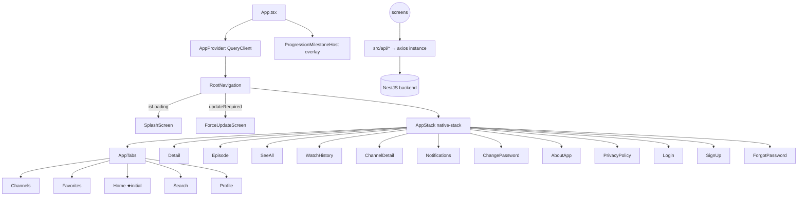

# Application Overview

## Product
- **Manhwaflix**: free animated **video recaps** of manhua/manhwa. A backend "chapter" is one Dailymotion video, shown as an "Episode" in the app ([[Glossary]]).
- Audience: mobile-first comic fans on Android, often binge-watching long series (100s of chapters), many on mid/low-end devices with flaky networks.
- Business model: AdMob banners and rewarded ads ([[Mobile-Ads]], [[Rewarded-Ads]]). Gamified retention via points, levels and ranks F→SSS ([[Points-Progression]]).
- Guests can browse and watch. An account unlocks favorites, history, progress sync, comments, subscriptions and rewards.
- Live on Play: 1.0.4 (versionCode 5). Android only ([[ADR-001-android-only-store-driven]]).

## Stack
| Layer | Tech |
|---|---|
| Runtime | React Native 0.83.1, React 19.2, New Arch + Hermes, arm64-v8a |
| Navigation | `@react-navigation` native-stack + bottom-tabs v7, custom `BottomTabBar` |
| Server state | TanStack Query v5 (`staleTime` 60s, `retry` 1, `src/providers/AppProvider.tsx`) |
| Client state | Zustand (`useAuthStore`, `useAppUpdateStore`) + MMKV ([[Mobile-State]]) |
| Network | axios, refresh interceptor (`src/network/instance.ts`) |
| Forms | react-hook-form + zod (`src/schemas/auth.ts`) |
| Video | Dailymotion native SDK, WebView fallback ([[Video-Playback]]) |
| Push | FCM + notifee ([[Push-Notifications]]) |
| Images | FastImage (`CachedImage`), Cloudinary avatar upload |
| Animation | Reanimated 4 installed; most screens use the RN `Animated` API |
| Installed but unused | `@react-native-community/netinfo`, `react-native-toast-message`, `react-native-bootsplash`, `react-native-keyboard-controller` (KeyboardProvider wrapping is not verified) |

## Architecture (as-is)

## Screen inventory (19 screens + 6 overlays)
| # | Screen | File | Lines | Auth | Notes |
|---|---|---|---|---|---|
| 1 | Splash | `screens/splash/SplashScreen.tsx` | ~170 | — | JS animation, 6s max |
| 2 | ForceUpdate | `screens/update/ForceUpdateScreen.tsx` | ~60 | — | blocks back |
| 3 | Login | `screens/auth/LoginScreen.tsx` | ~450 | guest | email + Google |
| 4 | SignUp | `screens/auth/SignupScreen.tsx` | ~600 | guest | 5 fields + terms |
| 5 | ForgotPassword | `screens/auth/ForgotPasswordScreen.tsx` | ~260 | guest | email link (web reset page on backend) |
| 6 | Home (tab) | `screens/app/HomeScreen.tsx` | ~550 | any | carousel + 4 rails |
| 7 | Channels (tab) | `screens/app/ChannelScreen.tsx` | 630 | should be auth | subscribed + recommended |
| 8 | Favorites (tab) | `screens/app/FavoritesScreen.tsx` | 727 | auth | grid, edit mode |
| 9 | Search (tab) | `screens/app/SearchScreen.tsx` | 1027 | any | genres, suggestions, history |
| 10 | Profile (tab) | `screens/app/ProfileScreen.tsx` | 1780 | any | profile + RPG + settings mixed |
| 11 | Detail | `screens/app/DetailScreen.tsx` | ~2074 | any | ~480 lines dead styles |
| 12 | Episode | `screens/app/EpisodeScreen.tsx` | ~1401 | any | player, up next, rewards |
| 13 | SeeAll | `screens/app/SeeAllScreen.tsx` | ~186 | any | params-only grid |
| 14 | WatchHistory | `screens/app/WatchHistoryScreen.tsx` | ~261 | auth | 100 cap |
| 15 | ChannelDetail | `screens/app/ChannelDetailScreen.tsx` | 763 | any | subscribe, alerts |
| 16 | Notifications | `screens/app/NotificationScreen.tsx` | 521 | should be auth | server + local inbox |
| 17 | ChangePassword | `screens/app/ChangePasswordScreen.tsx` | 285 | auth | no guard |
| 18 | AboutApp | `screens/app/AboutAppScreen.tsx` | 156 | any | copy says "reading" |
| 19 | PrivacyPolicy | `screens/app/PrivacyPolicyScreen.tsx` | 135 | any | generic, hardcoded |

**Overlays / hidden UI**
- O1 Edit-profile modal (Profile)
- O2 Author RPG-stats modal (comments)
- O3 Level-up milestone overlay (`ProgressionMilestoneHost`, global)
- O4 Reward points overlay (Episode)
- O5 Fullscreen player modal (`dailymotion-player-card`)
- O6 Favorites sort dropdown

## Feature list (as-is)
- Browse: featured carousel, continue watching, recently added, new updates, "recommended" (actually A–Z), See All.
- Detail: info, genres → search, favorite, like, share (text), episodes list, creator channel, recommendations, comments (threaded 3 levels, like/dislike, author stats modal).
- Watch: Dailymotion player with external controls (±10s, speed, captions, quality, fullscreen), progress sync every 15s, Up Next with 6s countdown, rewarded ad bonus.
- Search: genre filter grid, 6 suggestions, recent searches (auth), popular recommendations.
- Channels: subscribed (pin/unpin), recommended, channel detail (subscribe, upload alerts, uploads grid).
- Account: email/Google auth, forgot password (email link), change password, edit username/avatar, notification preferences (5 toggles + per-channel), release alerts (device-local), logout.
- Gamification: points, levels, ranks, RPG stats, level-up overlay.
- Push: FCM topic `new_releases`, per-user pushes, local inbox, deep-link routing via `navigationRef`.
- Force update via Play In-App Updates ([[In-App-Update]]).

## Backend capabilities not yet used by mobile
| Endpoint | Use in redesign |
|---|---|
| `DELETE /users/me` (password required) | Account deletion (R-10). Google-only accounts: open question, see [[Redesign-Decision-Log]] |
| `DELETE /comments/:commentId` | Delete own comment |
| `DELETE /watch-progress/:manhuaId` (`deleteWatchProgress` exists in `api/home-feed.ts:108`, unused) | Remove from Continue Watching |
| `GET /auth/reset-password` (web page) | Confirms password reset works via web; no in-app reset screen needed |
| Paginated `GET /favorites`, history | Infinite scroll (R-16) |

## Query keys (main)
`['manhuas','featured']` · `['home-feed', 'continue-watching'|'recently-added'|'new-updates']` · `['manhua',id]` · `['chapters',id]` · `['watch-progress',id]` · `['favorite-status',id]` · `['episode-like-status',id]` · `['comments',id]` · `['favorites',{…}]` · `['channels','subscribed'|'recommended'|'detail'|'subscription'|'sections']` · `['notifications','history'|'preferences']` · `['search-history','me']` · `['my-profile']` · `['watch-history','me']` · `['genres']`.
Known key mismatches → [[Redesign-UI-UX-Audit#Cross-cutting]].
