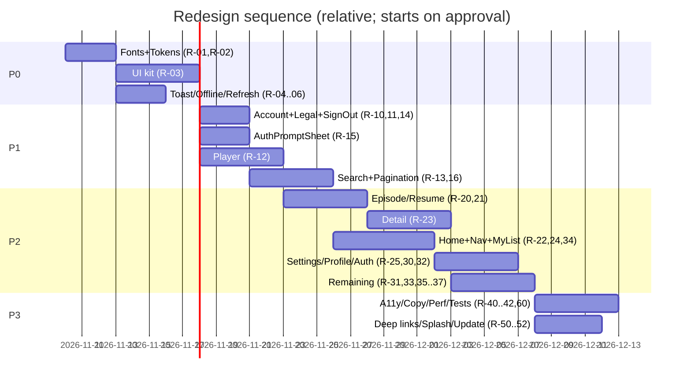

# Implementation Roadmap

> [!warning] Nothing here starts before the user's explicit approval ([[ADR-003-redesign-artifact-first]]).

- **Status per task:** `proposed` → `approved` → `implemented` → `tested`. All tasks are `proposed` as of 2026-11-08.
- **Rules:** preserve business logic, auth, API contracts and query keys (or migrate them with invalidation). Work screen by screen. Every PR runs `yarn type-check`, `yarn lint`, the QA checklist for the touched screens, and a release-build smoke test.
- **Effort:** S ≤1d, M 2–4d, L 5d+.

## P0: Foundation (blocks everything)
| ID | Task | Files | Effort | Status |
|---|---|---|---|---|
| R-01 | Bundle Urbanist TTFs, link assets (fontWeight cleanup moves to per-screen steps) | `src/assets/fonts/*`, `android/app/src/main/assets/fonts` | S | tested 2026-11-11 (user, physical device); implemented 2026-11-08 (`0014890`, branch `redesign/step-1-fonts-tokens`) |
| R-02 | Token module (color/type/space/radius/motion) + brand unification; deprecate old `COLORS` keys; hex-literal lint warning | `src/theme/tokens.ts`, `src/theme/index.ts`, `.eslintrc.js` | M | tested 2026-11-11 (user, physical device); implemented 2026-11-08; legacy `COLORS/FONT/SIZES` removed 2026-11-11 (Step 16) |
| R-03 | Core UI kit: Screen, AppHeader (renders `title`), Button, IconButton, TextField, Chip, SegmentedControl, SwitchRow, ListRow, Skeleton, EmptyState, ErrorState, BottomSheet, ConfirmSheet, Icon set | `src/components/ui/*`, `src/components/icons/*` | L | tested 2026-11-11 (user, physical device); implemented 2026-11-08 (`99eadc1`, branch `redesign/step-2-ui-kit`; Toast→Step 3) |
| R-04 | Toast system (`react-native-toast-message`, already installed) + `useMutationFeedback` helper | `App.tsx`, `src/components/ui/Toast.tsx`, `src/hooks/` | S | tested 2026-11-11 (user, physical device); implemented 2026-11-08 (`8619cbb`, branch `redesign/step-3-feedback-offline`) |
| R-05 | Offline + error infra: NetInfo → `onlineManager`, `focusManager` on AppState, OfflineBanner, root ErrorBoundary | `src/providers/AppProvider.tsx`, `src/components/ui/OfflineBanner.tsx` | M | tested 2026-11-11 (user, physical device); implemented 2026-11-08 (`8619cbb`, branch `redesign/step-3-feedback-offline`) |
| R-06 | `useRefreshControl` (only user-initiated refresh shows the spinner) | `src/hooks/` | S | tested 2026-11-11 (user, physical device); implemented 2026-11-08 (`8619cbb`, branch `redesign/step-3-feedback-offline`) |

**Acceptance criteria**
- [ ] Urbanist renders on a release build (checked visually against the system font).
- [ ] No new screen code uses hex/fontSize literals; ESLint rule added (warn level).
- [ ] Each UI kit component has a label/role, a 48dp target, pressed/disabled/loading states and a `testID`.
- [ ] Airplane mode shows the OfflineBanner within 2s; queries resume on reconnect.
- [ ] A thrown render error shows the ErrorBoundary fallback with Restart, not a crash.

## P1: Critical flows & policy
| ID | Task | Fixes | Files | Effort | Dep | Status |
|---|---|---|---|---|---|---|
| R-10 | Deletion **request** flow (D-19). Backend: `POST /account-deletion-requests/me` (auth) → create request with `userId`, set `isActive=false` + `moderationStatus='pending_deletion'`, revoke refresh tokens + push devices; reject → reactivate; approve → existing `deleteUserAccount`; login returns a distinct `ACCOUNT_PENDING_DELETION` error (no cancel path, D-22). Body `{ confirmation: "DELETE", reason? }` validated server-side; same for email + Google users. Admin: pending badge, userId link, "due in N days" (7-day window) highlight for overdue. Mobile: 3-step screen (explain → type DELETE → request received) → signOut | P-01 | `apps/backend/src/account-deletion-requests/*`, `auth/auth.service.ts`, `apps/admin/src/app/delete-account-requests`, new `DeleteAccountScreen` | M | — | tested 2026-11-11 (user, physical device); implemented 2026-11-08 (mobile `b13c8f3` on `redesign/step-8-settings-delete`; backend `3bec1a0` + admin `4f6a8f9` on `feat/account-deletion-me`; [[Account-Deletion]]) |
| R-11 | Privacy policy + Terms as hosted URLs (opened in WebView/Custom Tab); support email; About copy fix | PP-01, AB-01 | Privacy/About screens, env var for URL | S | hosted page | implemented 2026-11-11: hosted Privacy/Terms URLs + support email set in `.env`, `.env.stage`, `.env.prod` (Q-03); in-app Privacy page now only a fallback. Hosted policy gaps noted in [[Mobile-Settings]] |
| R-12 | Player: WebView fallback uses native chrome, error overlay + retry, single-instance fullscreen, draggable seek, settings sheet | E-01, E-04, E-05, E-10 | `components/dailymotion-player-card.tsx`, `EpisodeScreen.tsx` | L | — | tested 2026-11-11 (user, physical device); implemented 2026-11-08 (`d5af05c`, branch `redesign/step-6-episode-player`; WebView progress still N/A) |
| R-13 | Search results state: submit → paginated results, filters, empty/error | SR-01, SR-03, SR-04 | `SearchScreen.tsx`, `api/manhuas.ts` | M | verify text-search pagination endpoint | tested 2026-11-11 (user, physical device); implemented 2026-11-09 (mobile `f7d161e` on `redesign/step-11-search`, backend `f675d7f` on `feat/search-filters`; backend status/sort added; [[Mobile-Search]]) |
| R-14 | Central `signOut()` (store + query cache + push token); called on refresh failure and logout, with a confirm sheet | X-02, P-04 | `network/instance.ts`, `store/auth`, Profile | S | — | tested 2026-11-11 (user, physical device); implemented 2026-11-08 (`49db80c`, branch `redesign/step-4-session-cache-auth`) |
| R-15 | AuthPromptSheet + remove every dead end (guest rows, Preview, hidden Subscribe, search sign-in, Detail sort, guest Google button, rewarded card, Channels/Notifications guards) | P-02, P-03, CH-01, CH-02, CD-01, SR-02, D-02, D-04, E-07, N-02 | `hooks/use-auth-guard.ts`, affected screens | M | R-03 | implemented 2026-11-11 (Step 17, mobile `cfd5fe0` on `redesign/step-17-guest-dead-ends`): audit items already fixed in Steps 7–13 verified; email sign-in returns to the origin screen, one-tap Google on Profile, signed-out guard on account screens |
| R-17 | **Backend pagination sweep** (D-21): convert to `PaginationDto`/`PaginatedResult`: `GET /manhuas` (ListManhuasDto has none), `GET /manhuas/:id/chapters` (returns all; add page/limit + `order`, keep a light `?fields=index` list for prev/next), `GET /watch-history/me` + `GET /search-history/me` (limit/offset → page/limit), `GET /watch-progress/me` (limit only), `GET /manhuas/featured`. Raise `PaginationDto` max where needed (chapters 100). Keep suggestions/recommendations as limit-only (by design) | — | `apps/backend/src/{manhuas,chapters,watch-history,search-history,watch-progress}` | M | — | implemented 2026-11-11 (Step 18, backend `ed5193d` on `feat/pagination-sweep`): opt-in `page` on /manhuas, /featured, /chapters (+ `order`, `fields=list`), /watch-progress/me, /search-history/me; legacy arrays kept for 1.0.4 (D-41). Suggestions/recommendations stay limit-only |
| R-18 | **Ads placement map** (D-20): new placement ids + native ad card component, remove tab-bar banner, frequency caps | — | `src/constants/ad-placements.ts`, `src/components/AdBanner.tsx`, new `NativeAdCard`, `config/admob.ts`, env names | M | ad unit ids from AdMob | implemented 2026-11-11 (Step 20, mobile `d581749` on `redesign/step-20-ads`): NativeAdCard + 12 placements per map; Detail episode-list native deferred; needs Native unit id in env |
| R-16 | Infinite pagination: Favorites, Comments, Notifications, Collection (SeeAll), genre/search results, history | FV-01, CM-01, SA-01, H-04 | `useInfiniteQuery` in respective screens/api | M | verify `page` params per endpoint | implemented 2026-11-11: Favorites, Continue, History, Notifications, Comments, SeeAll, search/genre results all infinite; episode list stays full (slim `fields=list`, mobile `d52e528`); recents limit-only by design |

**Acceptance criteria**
- [ ] A test user can delete their account in ≤4 taps; afterwards the app is a guest and the backend returns 401 for the old token.
- [ ] A video forced onto the WebView path (no player id) can be played, paused, seeked, and shows an error UI for a bad id.
- [ ] Search "hunter" + submit shows a results grid that paginates past 20.
- [ ] Revoking the refresh token on the server → next API call → app shows the guest UI + "Session expired" toast.
- [ ] Every guest-gated action opens the AuthPromptSheet, and the action completes after login.
- [ ] A user with 30 favorites, 25 comments and 60 notifications can see all of them.

## P2: Screen redesigns (one PR per screen)
| ID | Task | Fixes | Effort | Status |
|---|---|---|---|---|
| R-20 | Episode: chapters-driven prev/next, persistent auto-play (`autoplay_next` MMKV), Up Next for guests, episodes drawer, sticky player, real titles | E-02, E-03, E-06, E-08, WH-01 | L | tested 2026-11-11 (user, physical device); implemented 2026-11-08 (`d5af05c`, branch `redesign/step-6-episode-player`) |
| R-21 | One-tap resume: Continue cards → Episode at saved position | H-01 | S | tested 2026-11-11 (user, physical device); implemented 2026-11-08 (`54e42b6`, branch `redesign/step-7-home-detail`) |
| R-22 | Home: HeroCard with Play, rail order, "Popular" rename, per-rail error, inline ad, FlatList rails | H-02, H-03, H-05, H-06 | M | tested 2026-11-11 (user, physical device); implemented 2026-11-08 (`54e42b6`, branch `redesign/step-7-home-detail`) |
| R-23 | Detail: hero CTA, Episodes tab first, virtualized EpisodeRow with watched/progress, sort + range + jump, dedupe synopsis, comments preview → sheet | D-01, D-03, D-05 | L | tested 2026-11-11 (user, physical device); implemented 2026-11-08 (`54e42b6`, branch `redesign/step-7-home-detail`) |
| R-24 | Navigation: new tab order Home·Search·My List·Channels·Profile, active indicator, re-tap scroll-to-top, remove the tab-bar ad | TB-01..04 | M | tested 2026-11-11 (user, physical device); implemented 2026-11-08 (`fd4a043`, branch `redesign/step-5-nav-shell`; Settings/DeleteAccount routes moved to Step 8) |
| R-25 | Settings screen (Notifications, Playback, Account, About & legal) split from Profile | P-06..P-08 | M | tested 2026-11-11 (user, physical device); implemented 2026-11-08 (mobile `b13c8f3`, [[Mobile-Settings]]) |
| R-30 | Auth screens on AuthLayout + TextField; remove Remember me; tappable Terms; consent for Google; friendly errors; ChangePassword rules checklist + show/hide | L-01..05, SU-01..04, FP-01..03, CP-01..03 | M | tested 2026-11-11 (user, physical device); implemented 2026-11-11 (mobile `9907ab7` on `redesign/step-14-auth`, backend `cf6c8dd` on `feat/register-auto-username`; [[Mobile-Auth]]) |
| R-31 | Cache consistency: shared `queryKeys` factory; like/fav/subscribe update all dependent keys; view recorded once per session per title | X-12, D-06, CM-03 | S | implemented 2026-11-11 (Step 19, mobile `af92cf9` on `redesign/step-19-cache-consistency`): all keys via `queryKeys` + lint guard, shared `useManhuaEngagement` (Detail+Episode, intent-based), view once per session |
| R-32 | Edit profile sheet: upload on Save only, resize, crop, remove with confirm, no raw URL | P-05 | S | tested 2026-11-11 (user, physical device); implemented 2026-11-09 (mobile `a5fe030` on `redesign/step-10-profile`, backend `82388c2` on `feat/profile-full-name`; no crop, resize only; [[Mobile-Profile]]) |
| R-33 | Comments: paginated sheet, optimistic votes, delete own, larger targets | CM-01..06 | M | tested 2026-11-11 (user, physical device); implemented 2026-11-11 (mobile `fe16717` on `redesign/step-15-comments`, backend `546d701` on `feat/comments-v2`; all merged to local `main`; full-screen route not sheet, + edit own, one-level replies, server sort, real myReaction; [[Mobile-Comments]]) |
| R-34 | My List tab (Continue / Favorites / History), remove + undo, grouped history, clear all with confirm | FV-02..06, WH-02..04, H-08 | M | tested 2026-11-11 (user, physical device); implemented 2026-11-09 (mobile `ef23390` on `redesign/step-9-my-list`, backend `7912fc1` on `feat/watch-history-manage`; no ads yet; [[My-List]]) |
| R-35 | Progression polish: one rank default label, absolute stat bars, icon set not emoji, safe-area overlays, a11y announce, reduced motion, stable `onComplete` | PG-01..04, X-19 | S | tested 2026-11-11 (user, physical device); implemented 2026-11-09 (mobile `a5fe030`; Profile + overlays; comments rank badge done in Step 15) |
| R-36 | Channels + ChannelDetail redesign: compact header, Discover with Subscribe, confirm unsubscribe, real date sort, error states | CH-03..05, CD-02..05 | M | tested 2026-11-11 (user, physical device); implemented 2026-11-09 (mobile `cadfd57` on `redesign/step-12-channels`, backend `c6906c6` on `feat/channels-cleanup`; [[Mobile-Channels]]) |
| R-37 | Notifications redesign: exclusive states, sections, instant navigation, local-first mark-all, category icons | N-01, N-03..06 | S | tested 2026-11-11 (user, physical device); implemented 2026-11-11 (mobile `5d7753a` on `redesign/step-13-notifications`, backend `a855175` on `feat/notifications-inbox`; + remove/undo, exact unread count, auth gate N-02; [[Push-Notifications]]) |

**Acceptance criteria (per screen)**
- [ ] Matches the [[Redesign-Visual-References]] wireframe and the [[Redesign-Strategy]] spec.
- [ ] Loading, empty, error and offline states all implemented and reachable.
- [ ] Zero hex/fontSize literals in the screen file.
- [ ] TalkBack can complete the screen's primary task.
- [ ] Layout intact at font scale 1.5.
- [ ] No regression in the existing behaviour list in [[Redesign-QA-Strategy]].

## P3: Polish & platform
| ID | Task | Effort | Status |
|---|---|---|---|
| R-40 | A11y sweep: labels/roles/states everywhere, `maxFontSizeMultiplier`, 48dp audit | M | implemented 2026-11-11 (Step 22, mobile `9cfbea0` on `redesign/step-22-a11y-copy`): header roles, decorative images, 48dp seek/chips, checklist in [[Mobile-UI-Kit]]; TalkBack + max font device pass pending |
| R-41 | Copy pass: video vocabulary ("watch", "episode"), remove dev strings, consistent "Ep N" | S | implemented 2026-11-11 (Step 22, mobile `9cfbea0`): notification actions/channel, fallbacks, alerts copy, friendly rewarded errors; rules in [[Mobile-UI-Kit]] |
| R-42 | Perf: memoized rows, stable callbacks (player `onProgressChange`), image sizing, shared shimmer, delete ~650 lines of dead styles | M | implemented 2026-11-11 (Step 23, mobile `594b96b` on `redesign/step-23-offline-cache`): persisted offline-first cache (ADR-005), instant boot from cache, Detail/Episode placeholders, long-list tuning; rows memo + player ref + dead styles done earlier |
| R-50 | Deep links + App Links (`linking` config, intent filters, `assetlinks.json`), share URLs | M | proposed (needs domain) |
| R-51 | Wire `react-native-bootsplash` (native splash → JS handoff) | S | implemented 2026-11-11 (Step 21, mobile `639ea75` on `redesign/step-21-splash-updates`; native rebuild needed) |
| R-52 | Flexible vs immediate update by Play priority; loading/error on the update button | S | implemented 2026-11-11 (Step 16 button states + Step 21 priority/flexible flow, mobile `639ea75`) |
| R-60 | Test infra: jest mocks (MMKV, Firebase, notifee, Google Sign-In, AdMob, Dailymotion), unit tests for schemas/queryKeys/mappers, component tests for the UI kit | M | proposed |

## Suggested sequence

## Traceability: Critical & High issues → tasks
| Issue | Task | | Issue | Task |
|---|---|---|---|---|
| X-01 | R-01 | | E-01, E-04 | R-12 |
| X-02 | R-14 | | E-02, E-03, WH-01 | R-20 |
| X-03 | R-05 | | H-01 | R-21 |
| X-04 | R-04 | | H-02 | R-05, R-22 |
| X-05, X-07 | R-03, R-40 | | D-01, D-03 | R-23 |
| X-06 | R-02 | | D-02, CH-01/02, CD-01, SR-02, N-02, P-02/03 | R-15 |
| X-10 | R-03 | | FV-01, CM-01, SA-01 | R-16 |
| X-15 | R-50 | | FV-02 | R-34 |
| P-01 | R-10 | | P-04 | R-14 |
| PP-01 | R-11 | | P-05 | R-32 |
| SR-01, SR-03 | R-13 | | N-01 | R-37 |
| L-01, SU-01 | R-30 | | | |
