# User Flows

Red nodes = current pain points (issue IDs from [[Redesign-UI-UX-Audit]]).

## 1. Resume watching
**Current: 3 taps, chain breaks**
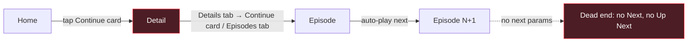
**Improved: 1 tap, endless chain**
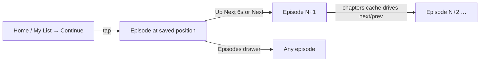

## 2. Discover → watch
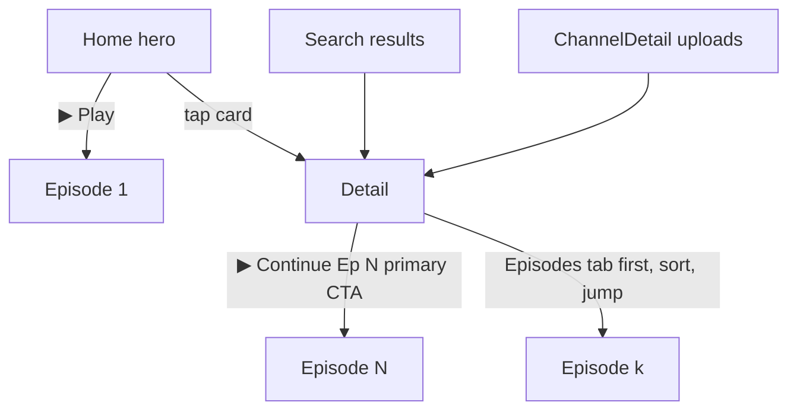

## 3. Search
**Current**
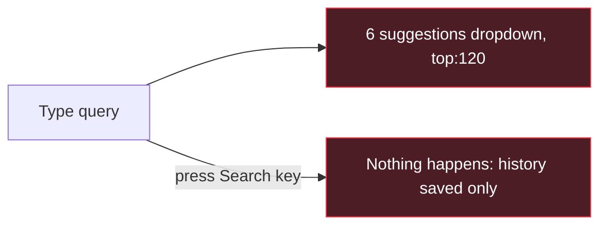
**Improved**
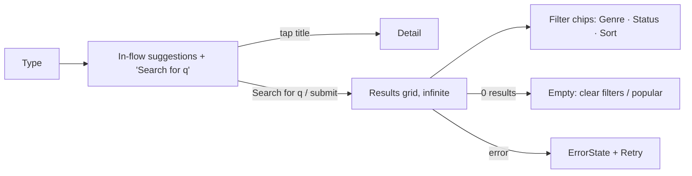

## 4. Guest → account (gated action)
**Current: dead ends**
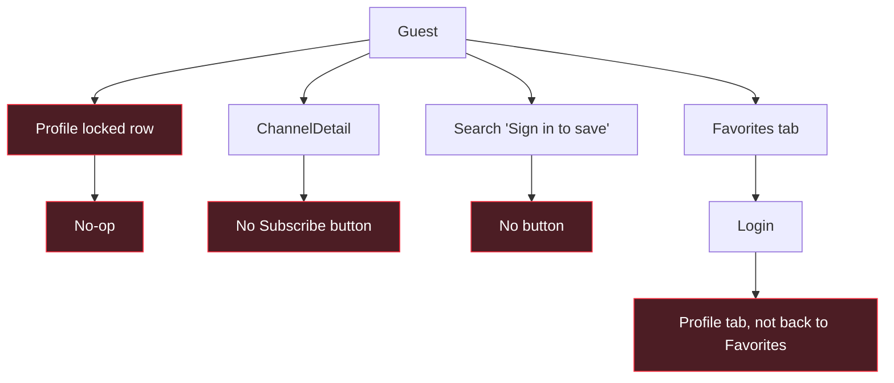
**Improved: AuthPromptSheet + action replay**
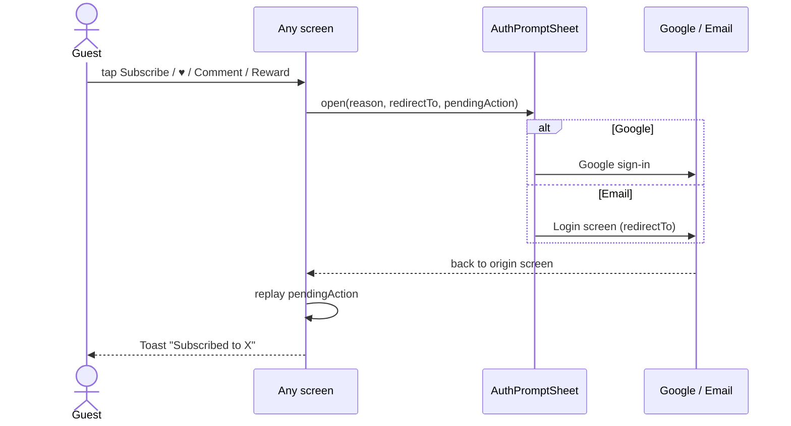

## 5. Notification → content
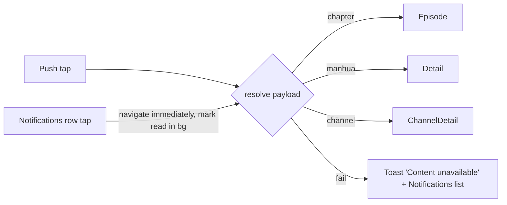

## 6. Share / deep link (new)
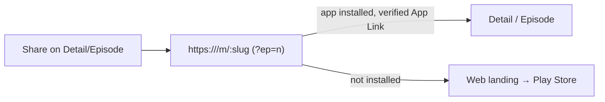

## 7. Account management & deletion request (D-19)
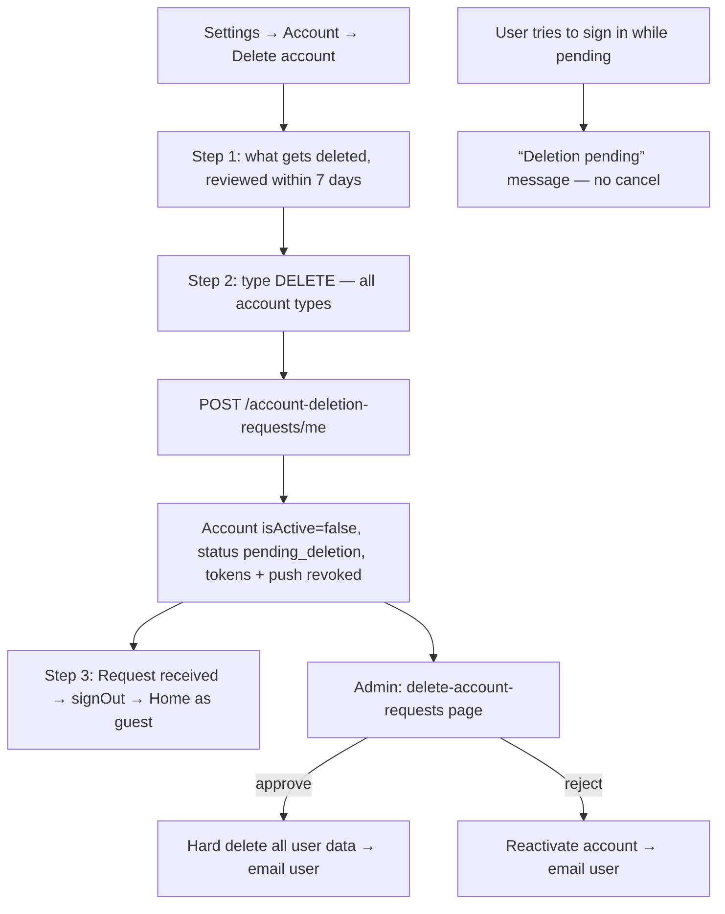

## 8. Logout & session expiry
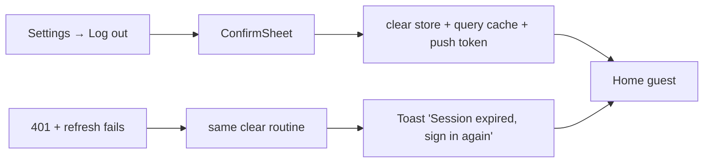

## 9. Onboarding (first launch)
- **Current:** splash goes straight to Home. No orientation.
- **Proposed (minimal):** splash → Home. Add a one-time dismissible coach card on Home: "Tap ▶ to watch · ♥ to save · earn XP by watching". No forced signup, no multi-screen carousel (rejected in [[Redesign-Product-Gaps]]).
